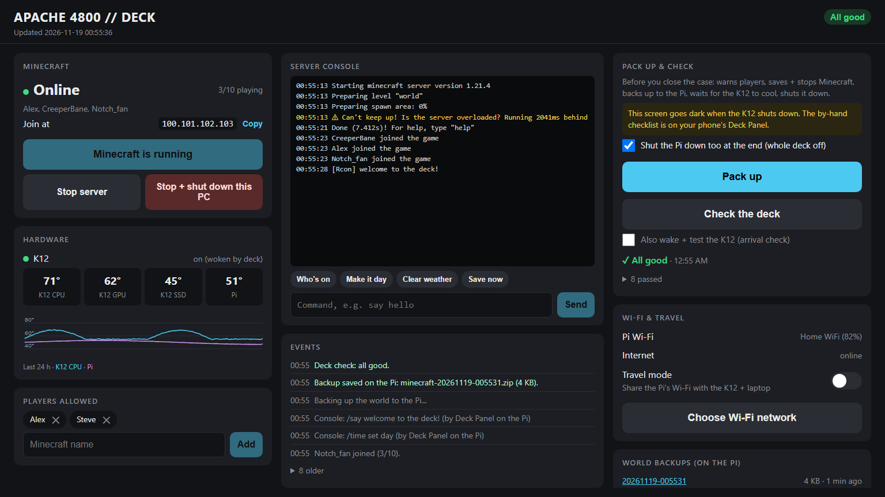

# Apache 4800 Cyberdeck: Software Kit

A portable second computer built into an Apache 4800 case: a **Raspberry Pi 5** runs the Deck Panel
(a phone/screen control panel), a watchdog and a Discord bot, and a **mini PC** runs a Minecraft server
in Docker that friends join over Tailscale. A laptop can plug into the case too.

Everything needed to set up the PC, the Raspberry Pi 5 and the laptop is here.



## Quick start: the one-click installer

1. **Get the kit:** on GitHub press **Code › Download ZIP**, then right-click the zip › **Extract All**.
   (Or `git clone` this repo.)
2. Double-click **`Install.cmd`**. Don't use "Run as administrator": steps ask for admin themselves.
3. Pick the steps in order. Each one explains what it does, asks before changing anything, shows ✓ when
   done, and is safe to run again:

| | Step | Where to run it |
|---|---|---|
| 1 | **The mini PC**: apps, Docker, Minecraft server, case network | the mini PC |
| 2 | **The Raspberry Pi**: copies `pi5/` over SSH and runs its setup | any Windows PC on the same Wi-Fi |
| 3 | **Link PC ↔ Pi**: lets the Pi start/stop Minecraft and read temperatures; installs the Deck app | the mini PC |
| 4 | **The laptop** (optional) | the laptop |
| 5 | **Game-dev extras for Claude** (optional): MCP servers for Unity, Godot, Blender, Gemini and a free-asset library ([dev-extras/README.md](dev-extras/README.md)) | the mini PC |
| 6 | **Try it first**: the panel and the Deck app with pretend hardware, no deck needed | any Windows PC |
| 7 | **Run the tests** | any Windows PC with Python |

The rest of this README explains each part in detail, and how to do every step by hand.

## What's in the kit

```
cyberdeck/
  README.md                  <- you are here
  Install.cmd                the walkthrough installer (installer/Install.ps1)
  dev-extras/                optional: MCP servers + scripts for game dev with Claude
  try-the-panel.cmd          try the Deck Panel on this PC with pretend hardware
  try-the-k12-app.cmd        try the PC's Deck app (native) the same way
  install-pc.cmd             sets up the whole mini PC in one go (steps 2, 3 and 6 + Docker + Minecraft)
  tests/run-tests.cmd        automated checks of the Pi + PC software (pretend hardware)
  k12-info.txt               <- created by the PC script (name + MAC)
  k12-windows/
    setup-k12-network.cmd    step 2 - case network, wake-up, power (admin)
    install-apps.cmd         step 3 - apps, mono audio, Minecraft files (NOT admin)
    setup-k12-agent.cmd      step 6 - lets the Pi start/stop Minecraft, read temps
    setup-curseforge.cmd     modpacks - saves your CurseForge key on the PC
    agent/deck-agent.ps1     the only commands the Pi may run on the PC
    app/DeckApp.cs           the Deck app (Deck.exe) on the PC's own screen, built + installed by step 6
    app/Deck.ps1             fallback: the panel in an Edge window
    game-servers/            Minecraft (Docker), copied to C:\deck\game-servers
    ci-runner/               optional GitHub Actions runner
  pi5/
    setup-pi.sh              step 4 - Tailscale, Uptime Kuma, deck services
    deckpanel.py + panel.html  the Deck Panel (phone + PC screen): Minecraft, console, temps, Wi-Fi...
    manifest.json + icon-*     home-screen app name and icon
    deckwatch.py             watchdog: temperatures, players, idle stop
    deckbot.py               Discord bot
    deck-net                 root helper for Wi-Fi + travel mode
  laptop-windows/
    setup-laptop.cmd         step 5 - laptop side of the case network
    undo-laptop.cmd          put the laptop Ethernet back to normal
    travel-on.cmd / travel-off.cmd   laptop internet through the deck
  cad/                       OpenSCAD sources + STL files for the printed parts
  keybind-mod/               the Keybind Presets mod (Forge + Fabric 1.20.1), see its README
  docs/                      keybind-preset-format.md: the preset file the mod and the deck share
```

## Try the panel first (no hardware needed)

Double-click **`try-the-panel.cmd`**. It needs Python: `winget install Python.Python.3.12`. Your browser opens `http://127.0.0.1:8090/demo`, where:

* **Middle:** the real Deck Panel at phone size. Every button works.
* **Left:** buttons that cause trouble: players joining and leaving, the PC overheating, the Pi getting hot, the temperature app stopping, Wake-on-LAN failing, the EULA not accepted, a power cut, a hotel login page, lost Wi-Fi, an unplugged case cable. Pack up, backups and the player list all work too. To test the typo check, add the name `NotARealPlayer`.
* **Right:** what the Discord bot would post in its channel.

The panel, watchdog and messages are the real code. Only the PC, Minecraft and Wi-Fi are pretend, and time runs about 10× faster: the idle stop takes 1 minute instead of 20. Nothing real is touched: no wake packets, no SSH, no Wi-Fi changes. In the demo, locked Wi-Fi networks use the password `password123`.

* **The PC's Deck app:** double-click **`try-the-k12-app.cmd`** instead. It builds and opens the native Deck app the PC shows on the deck's screen, talking to the same pretend hardware (an export zip you import there goes to a temp folder, not a real server).
* To try it on your phone, run `python pi5\deck-demo.py --lan`, then open `http://<this PC's IP>:8090/` on the phone. It must be on the same Wi-Fi, and Windows may ask to allow Python through the firewall.
* To stop the demo, close its window.

## Network addresses

The 5-port switch inside the case is a private network between the three machines. It has no router and no DHCP, so every machine gets a fixed address. None of these ports gets a gateway, so internet traffic keeps using Wi-Fi.

| Machine | Port | Case network IP | Internet via |
|---|---|---|---|
| Raspberry Pi 5 | Ethernet (eth0) | **10.48.0.2** | Wi-Fi |
| PC (Minisforum UM870 Slim) | Ethernet (its only port) | **10.48.0.10** | Wi-Fi (the Pi in travel mode) |
| Alienware laptop | Ethernet | **10.48.0.20** | Wi-Fi (the Pi in travel mode) |

Ports: Deck Panel `8080` (Pi), Uptime Kuma `3001` (Pi), DNS `53` (Pi, case network only, used in travel mode), Minecraft `25565` (PC), SSH `22` and LibreHardwareMonitor `8085` (PC, case network only).

---

## Step 1: Flash the Pi

1. Use Raspberry Pi Imager and pick **Raspberry Pi OS Lite (64-bit)**.
2. In the Imager settings (gear icon / "Edit settings"):
   * Hostname: **`deckpi`**
   * A username and password
   * Wi-Fi: your home network
   * Services: **enable SSH**
3. Put the card in the Pi, plug its Ethernet into the case switch and power it on.

## The quick way: set up the whole PC in one go

(`Install.cmd` › 1 runs this for you.) Copy this whole `cyberdeck` folder to the mini PC (download it, or plug in a USB drive with it), connect the PC to **Wi-Fi**, plug its Ethernet port into the case switch, and double-click **`install-pc.cmd`**. Don't use "Run as administrator": it asks for admin itself (click **Yes** when Windows asks).

It does steps 2, 3 and 6 below for you, plus what they leave to you:

1. **Checks the PC**: Windows version, winget, internet, virtualization (Docker needs it), memory, free space, Ethernet port.
2. **Turns on WSL**, which Docker runs on, then does Step 2 (case network, wake-up, power). You pick the Ethernet port as described there.
3. **Installs the apps**: Step 3 (Docker Desktop, PowerToys, Tailscale, Git, Discord, Spotify, mono audio, WSL limits, Minecraft files).
4. **Restarts the PC.** After you sign back in, the installer opens again by itself and carries on.
5. **Starts Docker Desktop** (click Accept on its terms; signing in to Docker isn't needed) and downloads the Minecraft server.
6. **Asks for your CurseForge key** (you can skip it and add it later).
7. **Asks the Minecraft questions**: do you agree to the EULA, who may join, and who the operators are.
8. **Links the PC to the Pi** (Step 6). This only happens once the Pi is set up. If the Pi isn't ready yet, run `install-pc.cmd` again after Step 4, and it does only this part.

It's safe to run again: it remembers what's done (in `C:\deck\setup-progress.json`) and carries on where it stopped. It copies itself to `C:\deck\setup-kit`, so the USB drive can be unplugged after the restart. At the end it lists what only you can do: the BIOS settings, signing in to Tailscale, Mouse Without Borders, and the two commands to run on the Pi.

* `install-pc.cmd -Check` only looks. It shows what the PC has and which steps are done, and changes nothing.
* `install-pc.cmd -Redo` goes through every step again.
* Run it again later and say **y** to update the PC's deck files after you change the cyberdeck files.

The individual steps below still work on their own.

## Step 2: PC network (as admin)

Plug the PC's **Ethernet port** into the case switch first (the UM870 Slim has just one, so its internet is always Wi-Fi), then double-click **`k12-windows\setup-k12-network.cmd`**.

* It shows the Ethernet ports and guesses which one goes to the switch (the one with no router). Press Enter to accept, or type the number.
* It saves the PC's name and MAC to `k12-info.txt` on this drive.
* At the end it prints a **BIOS checklist** (Wake on LAN, power on after AC loss, ErP off, a lower power mode if the BIOS has one). Do it, then restart once.

## Step 3: PC apps (normal user, NOT admin)

Double-click **`k12-windows\install-apps.cmd`**. It installs PowerToys, Docker Desktop, Tailscale, Git, Discord and Spotify. It also turns on Mono audio and sets the WSL2 limits, and copies the Minecraft files to `C:\deck\game-servers`.

Then:
1. Open Docker Desktop once and accept its terms. Turn on **Settings > General > Start Docker Desktop when you sign in**.
2. Edit `C:\deck\game-servers\.env`:
   * Read the Minecraft EULA and set `MC_EULA=TRUE`.
   * Add your friends' usernames to `MC_WHITELIST_PLAYERS`.
   * Pick `MC_TYPE` (VANILLA / PAPER / FABRIC / NEOFORGE).
3. Run `C:\deck\game-servers\start-minecraft.cmd`. The first start takes a few minutes.

Minecraft extras in that folder:

* `minecraft-console.cmd`: type server commands such as `whitelist add Name`.
* `backup-minecraft.cmd`: zips the world to `C:\deck\backups` and keeps the newest 10. To run it nightly, add it to Task Scheduler.
* `stop-minecraft.cmd`: saves the world and stops the server.

The server is capped at **6 threads / 8 GB**, and all of Docker at 8 threads / 20 GB (of the PC's 32 GB), so Discord and the second screen stay smooth.

## Step 4: Pi setup

`Install.cmd` › 2 does this for you. By hand: copy the `pi5` folder to the Pi. From the PC (or any other Windows computer on your Wi-Fi), open PowerShell:

```
scp -r F:\cyberdeck\pi5 <your-pi-username>@deckpi.local:~
ssh <your-pi-username>@deckpi.local
sudo bash ~/pi5/setup-pi.sh
```

The script:

1. Sets eth0 to 10.48.0.2.
2. Installs **Tailscale** and prints a sign-in link. Open it, then install Tailscale on your phone with the same account.
3. Installs Docker + **Uptime Kuma**.
4. Creates a user called `deck` and installs three services that run as it: the **Deck Panel** (web page), **deckwatch** (watchdog) and **deckbot** (Discord, off until you set it up). It also makes the SSH key the Pi uses to talk to the PC and copies the public half to `pi5/deck-pi.pub`.
5. Sets up **travel mode**: `deck-net` (the one command the panel may run as root) and dnsmasq answering DNS on 10.48.0.2 only. dnsmasq does DNS only, not DHCP.
6. Installs `discord.py` in `/opt/deck/venv`.
7. Finds the PC's MAC by itself if the PC is on. If it can't, run `sudo deck-set-mac` later, or `sudo deck-set-mac AA:BB:...` with the MAC from `k12-info.txt`.

Commands on the Pi: `wake-k12`, `deck-status`, `sudo deck-set-mac`, `sudo deck-link-k12 <user>`, `sudo deck-discord-setup`, `sudo deck-tailscale-setup`, `sudo deck-curseforge-setup`. Logs: `journalctl -u deckwatch` (or `deckpanel`, `deckbot`).

Already ran an older version with Pi-hole? Run `pihole uninstall` first, because it also uses port 53.

**Setting up on a desk, with the Pi wired to a PC or router for internet** (for example, school Wi-Fi with a login page the Pi can't use): that works. The script sees that eth0 is the internet connection and skips step 1, so it doesn't cut itself off. **Run it again once the Pi is in the case** to put eth0 on the case network. To share a Windows PC's internet over a cable: `ncpa.cpl`, then your internet adapter, then **Properties**, the **Sharing** tab, tick the box, and pick the adapter the Pi is plugged into. The Pi then appears at 192.168.137.x.

**Pi Wi-Fi shows "switched off"?** Some fresh Raspberry Pi OS installs start with the Wi-Fi radio off, and then the Wi-Fi settings from Imager do nothing. **Choose Wi-Fi network** on the Deck Panel switches it on and scans.

### One panel, two screens

There's one Deck Panel, served by the Pi, and two ways to look at it. Both always show the same thing, and a fix to one is a fix to both.

| | Phone | PC (the deck's own screen) |
|---|---|---|
| How you open it | `http://deckpi:8080`, saved to your home screen | the **Deck** icon (Start menu, desktop, or opens at sign-in) |
| Layout | one column, links at the top to jump around | three columns, everything visible at once |
| Works away from the deck | yes, over Tailscale | - |

### Using it from your phone

* **Deck Panel:** open `http://deckpi:8080` in the phone browser while Tailscale is on (from the laptop: `http://10.48.0.2:8080`). Add it to your home screen (iPhone: Share → Add to Home Screen; Android: ⋮ → Add to Home screen) so it opens like an app. It shows:
  * **Top bar**: one status word ("All good", "PC warm", "Pi offline", "Check failed"…). Tap it to jump to the card that needs you. The row of links below jumps to each card.
  * **Minecraft**: Start (wakes the PC first if needed), Stop, and Stop + shut down PC. Also who's playing and the join address, with a **Copy** button to paste it to friends.
  * **Hardware**: PC CPU/GPU/SSD and Pi temperatures, with a 24-hour graph.
  * **Events** (at the bottom): the same messages the Discord bot posts. While something is running, the newest one also shows on the Minecraft card.
  * **Server console**: the Minecraft server's live log, a command box (`say hello`, `time set day`, `gamemode creative Steve`…) and buttons for the usual ones. It refuses `stop` and `whitelist`, because the Stop button and Players allowed do those properly (backup, start-up list). It also refuses quotes, braces and `; $ | &`. Every command you send is written to Events. On a phone the log only updates while the card is on screen.
  * **Wi-Fi & travel**: covered under [Travel mode](#travel-mode).
  * **Players allowed**, **Pack up & check** and **World backups**: covered further down.
* Backup: SSH in with the Tailscale app (or Termius) and run `wake-k12`.
* The page stops checking while it's in the background or the phone is locked, and catches up as soon as you look at it again.
* The page only answers your Tailscale devices, the Pi itself and the case network. Buttons only work from the page itself, so other websites can't press them.

### Uptime Kuma (phone alerts)

Open `http://deckpi:3001` and create an account. Add these monitors:

| Type | Name | Host | Port |
|---|---|---|---|
| Ping | PC | 10.48.0.10 | - |
| TCP Port | Minecraft | 10.48.0.10 | 25565 |
| Push | Deck temperatures | (Kuma gives you a URL) | - |

For the **Push** monitor, copy the URL Kuma shows into `"kuma_push_url"` in `/etc/deck/config.json`, then run `sudo systemctl restart deckwatch`. Kuma then alerts you if the deck gets hot, or if the watchdog stops reporting.

For alerts, go to Settings > Notifications. The **ntfy** or **Pushover** app on your phone works well.

## Step 5: Laptop

Plug the laptop's Ethernet into **side-panel jack 2**, then double-click **`laptop-windows\setup-laptop.cmd`**. It sets 10.48.0.20, installs PowerToys and tests the link to the PC and the Pi.

**Mouse Without Borders** (PowerToys) on both PCs:
1. Use the same security key on both.
2. In **IP address mapping**, put:
   ```
   <laptop name> 10.48.0.20
   <PC name>    10.48.0.10
   ```
   Both names are printed by the scripts, and the PC's is also in `k12-info.txt`. This forces mouse sharing over the cable instead of Wi-Fi.

If you ever plug the laptop's Ethernet into a router instead, run `undo-laptop.cmd`.

## Step 6: Link the PC to the Pi

This lets the Pi start and stop Minecraft, read temperatures and switch travel mode. **Run setup-pi.sh first**, because the PC needs the Pi's key.

1. On the PC, double-click **`k12-windows\setup-k12-agent.cmd`**. It asks for admin, then:
   * Installs **OpenSSH Server**. It's key-only, reachable only from 10.48.0.2, and the Pi's key is locked to `deck-agent.ps1`, so the Pi can run only the commands listed in that file. It can't open a shell.
   * Installs **LibreHardwareMonitor** to `C:\deck\lhm`. It starts at sign-in with its web page on port 8085, reachable only from the case network. If it asks to install the **PawnIO** driver, say yes: that's how it reads the CPU temperature.
   * Makes a task that lets the agent start **Docker Desktop**, and sets Docker to start at sign-in.
   * Installs the **Deck app** to `C:\deck\app`, with a **Deck** icon on the desktop and in the Start menu. It asks whether to open it every time Windows signs in: say yes if the case screen is the PC's. See [The Deck app on the PC](#the-deck-app-on-the-pc).
   * Checks **automatic sign-in**. A woken PC has to reach the desktop for Docker and Minecraft to run. It offers Microsoft's **Autologon** tool, which stores your password encrypted. You type the password into Autologon yourself. Trade-off: anyone who powers on the PC lands on your desktop.
   * Prints a line like `sudo deck-link-k12 yourname`.
2. On the Pi, run that line. It records the PC's SSH key, tests the link and prints **Linked.**

Your PC account should be an administrator (the usual case). Travel mode needs that.

### The Deck app on the PC

Click **Deck** on the PC. It's a small native Windows app (`C:\deck\app\Deck.exe`, about 25 MB of memory, no browser) that talks to the Pi, so it always shows the same things as your phone. `setup-k12-agent.cmd` builds it with the C# compiler Windows already has: nothing extra is installed. Pages down the left:

* **Overview:** Minecraft (Start, Restart, Stop, Stop + shut down this PC), who's on, the join address with **Copy**, temperatures, and Events.
* **Console:** the server's live log, a command box and the usual quick buttons.
* **Players:** who's online, with **Kick**, **Ban**, **Make operator** and **Game mode** buttons; who may join (add / remove, checked with Mojang); bans and **Unban**.
* **Server:** **performance** (ticks per second, time per tick, the server's CPU and memory) and the **server settings**: difficulty, server name, max players, memory, version and type (every world), plus game mode, view / simulation distance, PvP, monsters, flying, spawn protection, command blocks and hardcore (each world keeps its own). **Save changes**, then **Restart Minecraft now** to use them. Settings a modpack sets itself (its memory) are greyed out.
* **Modpacks:** what's installed and which is on, Switch / Delete, install from a CurseForge link, **import a CurseForge export zip** (see [Import your own pack](#import-your-own-pack-a-curseforge-export)), and the progress of the last switch.
* **Backups:** the world backups on the Pi: **Back up now**, **Download selected**.
* **Pi & deck:** Wi-Fi + travel mode, **Check the deck**, **Pack up**, **Restart the Pi** / **Shut the Pi down**, and the **deck settings** (idle stop, join address, modpack memory, temperature limits, backups to keep, pack-up warning and cool-down). The Pi uses changed settings right away.

Keybind presets, uploading mods you downloaded by hand and choosing a Wi-Fi network open the full panel in your browser (**Full panel ↗**, top right).

#### No Pi? Standalone mode

The Pi doesn't have to be there. When the app can't reach it (left at home, not plugged in, still being set up), it says **Standalone (no Pi)** at the top and runs the deck from the PC itself, within a few seconds of opening:

| Works without the Pi | Waits for the Pi |
|---|---|
| Start, Stop, Restart, Stop + shut down this PC | Deck settings (Pi & deck page) |
| Who's on, join address, temperatures, Events | Wi-Fi + travel mode |
| Console: the log and commands | Pack up, Check the deck, Pi restart / shut down |
| Players: kick, ban, op, game mode, who may join (checked with Mojang) | The phone panel, the Discord bot, Uptime Kuma alerts |
| Server: performance and every server setting | Installing from a CurseForge **link** (import an **export zip** instead) |
| Modpacks: switch, delete, **import an export zip** | The auto-fix for client-only mods, keybind presets, uploading mods by hand |
| Backups: back up now and download (kept on the PC, in `C:\deck\backups`) | Copies of backups on the Pi |

It also keeps a light watchdog while it's open: an empty server stops after 20 minutes, and if the PC's CPU stays at 92 °C for a minute it warns players, saves and stops Minecraft (85 °C gets a warning). Unlike the Pi's, it only watches **while the Deck app is open**.

It keeps looking for the Pi (every 15 seconds at first, then every 30) and switches back by itself as soon as the Pi answers. Nothing needs setting up: the Deck shortcut works the same either way. Standalone only runs on the deck's own PC (it uses `C:\deck\agent\deck-agent.ps1`, the same commands the Pi uses).

Without the app, `C:\deck\game-servers\start-minecraft.cmd`, `stop-minecraft.cmd`, `minecraft-console.cmd` and `backup-minecraft.cmd` still work too.

* **Light on the PC:** it only asks the Pi for what the page on screen shows, half as often while another window is in front, and **nothing at all while minimized**.
* **Pack up from the PC:** this screen goes dark when the PC shuts down, so the by-hand checklist is on your phone instead. The PC's Pack up has a tick box, on by default, to **shut the Pi down too** once everything went well, so the whole deck ends up off. If any step had a problem, the Pi stays on so you can look from your phone.
* **Pi not answering?** The top bar says so and it keeps retrying every 10 seconds. Started at sign-in, it says "Waiting for the Pi" for the first 3 minutes, because the Pi boots slower than the PC.
* Turn open-at-sign-in on or off by running `setup-k12-agent.cmd` again. It's safe to rerun, and it updates the app too.
* If the app can't be built, the Deck shortcut opens the panel in an Edge window instead (the old way).

## Discord bot

| Command | Who |
|---|---|
| `/mc status`, `/deck temps`, `/mc modpack list` | anyone |
| `/mc start`, `/mc stop`, `/mc off` (stop and shut the PC down), `/mc backup`, `/mc whitelist list`, `/deck check [full]` | `deck-admin` role |
| `/mc whitelist add` / `remove`, `/mc invite @friend <minecraft name>`, `/deck pack`, `/mc modpack install` / `switch` / `vanilla` | **only you** (the owner ID you enter in step 6) |

The bot also posts in one channel when:
* the server comes up or goes down
* people join or leave
* the empty server is stopped
* a heat warning fires
* a backup is saved
* someone is added to the whitelist
* a modpack is installed or switched (with a "How to join" message for players), or needs a mod downloaded by hand
* you pack up
* the deck checks itself after starting

It only connects out to Discord, so no ports are opened.

1. Go to https://discord.com/developers/applications > **New Application** (for example "Deck").
2. Open **Bot** > **Reset Token** and copy the token. Treat it like a password.
3. Open **OAuth2 > URL Generator**. Tick `bot` and `applications.commands`, then under bot permissions tick **Send Messages** and **Embed Links**. Open the URL it makes and add the bot to your server.
4. In your Discord server, create a role called **`deck-admin`** and give it to yourself and anyone else who may start or stop the server. Anyone can use `/mc status` and `/deck temps`.
5. Discord Settings > Advanced > turn on **Developer Mode**. Then copy three IDs:
   * your announcement channel: right-click it > **Copy Channel ID**
   * your server: right-click its icon > **Copy Server ID**
   * **yourself**: right-click your own name > **Copy User ID**
6. On the Pi: `sudo deck-discord-setup`. Paste the token (it's hidden while you type), then the IDs. Your user ID makes you the **owner**, the only one who can let people in. It starts the bot and prints the log if something's wrong.

The token is stored in `/etc/deck/discord.env`, which only root and the bot can read. It's never put on this USB drive.

## Friends join over Tailscale

The PC already runs Tailscale, so friends join through it. No router port forwarding is needed. Only you decide who gets in.

**The one-step way: `/mc invite @friend TheirMinecraftName`** in Discord. The bot:
1. checks the Minecraft name is a real account and adds it to the whitelist,
2. makes a **one-time Tailscale link that shares only the PC** (never the Pi or anything else on your tailnet),
3. DMs your friend three steps: install Tailscale, open the link, join at this address.

If their DMs are closed, the bot shows you the message to forward instead.

For step 2 the Pi needs a Tailscale API key, once:
* Tailscale admin console > **Settings > Keys** > **Generate access token**.
* On the Pi, run `sudo deck-tailscale-setup` and paste the token.

These tokens expire (you choose 1–90 days). When invites say the key was rejected, make a new one and run that command again. Without a key, `/mc invite` still whitelists and DMs your friend; you then share the PC by hand: admin console > Machines > the PC > **Share**.

**Just the whitelist:** use `/mc whitelist add|remove Name` in Discord, or the **Players allowed** card on the Deck Panel. Every name is checked with Mojang first, so typos get caught. Removing someone also kicks them if they're playing. If the PC is off, the change waits (shown faded on the panel) and happens the next time it starts. The deck keeps `MC_WHITELIST_PLAYERS` in `.env` in step, so a restart never undoes a change.

Friends join at the PC's Tailscale IP (`100.x.y.z`). The bot and the panel show it as "Join at". To show a different name, set `"mc_join_address"` in `/etc/deck/config.json`.

**Empty server:** after 20 minutes with nobody on, the watchdog saves the world and stops Minecraft. If the deck woke the PC for it, the PC also shuts down again. If you turned the PC on yourself, it stays on. Windows shows a 1-minute warning before shutting down (cancel with `shutdown /a`). To change the delay, set `"idle_stop_minutes"` in `/etc/deck/config.json` (0 = never).

## World backups (on the Pi)

Copies of the world are kept on the **Pi**, so a dead PC drive doesn't take your world with it. No extra hardware is needed.

* **When:** whenever the server stops (at most once an hour), every Pack up, before every modpack switch, and when you press **Back up now** or use `/mc backup`. Heat emergencies skip the backup so the PC can cool down.
* **How:** the PC zips the world, pausing autosave while it copies so nothing is half-written. The Pi pulls the zip over the case cable and checks its checksum, so a broken copy is thrown away and never kept. Logs, caches, mods and the server program are left out because they re-download.
* **Names:** the vanilla world's backups are `minecraft-<date>.zip`. A modpack's are `pack-<name>-<date>.zip`.
* **Kept:** the newest 10 **of each world** on the Pi (`backup_keep`) and on the PC in `C:\deck\backups`, so backups of one pack never push out another's. The Pi always leaves at least 1 GB free.
* **Get one:** Deck Panel > **World backups**. Tap a backup to download its zip.
* **Restore:**
  1. Stop Minecraft.
  2. On the PC, find the world's folder: `C:\deck\game-servers\data\minecraft\` for vanilla, `C:\deck\game-servers\data\packs\<name>\` for a modpack. Rename the `world` folder inside it to `world-old`.
  3. Unzip the backup into that folder.
  4. Start Minecraft again.

## Modpacks

The server can run a **CurseForge modpack** instead of plain Minecraft. Each pack keeps **its own world**, so you can switch between Vanilla and different packs without losing anything.

### One-time setup: the CurseForge key

The server needs a free CurseForge API key to download packs.

1. Go to https://console.curseforge.com/, sign in (or make a free account) and open **API keys**. Copy your key. It starts with `$2a$10$`.
2. **On the PC:** double-click **`k12-windows\setup-curseforge.cmd`** and paste the key. It's saved in `C:\deck\secrets\`, never on this USB drive.
3. **On the Pi:** run `sudo deck-curseforge-setup` and paste the same key. The Pi uses it to show the pack details before you install.

Updating an existing deck? Run `setup-k12-agent.cmd` on the PC once more first, so the PC gets the new modpack commands.

### Install a pack

1. Find the pack on curseforge.com and copy its page link, for example `https://www.curseforge.com/minecraft/modpacks/<name>`.
2. Deck Panel > **Modpacks**: paste the link and press **Look up**. You'll see the name, picture, Minecraft version, mod loader (Forge, NeoForge or Fabric) and version.
3. Press **Install**. The deck warns anyone playing, saves and backs up the current world, switches, starts the server and watches it load. Every step gets a ✓ or ✕.

The **first start downloads every mod**, which can take 10 minutes or more. Starting the pack again later is much faster.

In Discord: `/mc modpack install <link>` shows the same details with an **Install** button (only you).

* **Which version:** a pack page link installs the newest version. A link to one file (`.../files/1234567`) installs exactly that version.
* **Memory:** a modpack server may use 10 GB (`modpack_mem_gb` in `/etc/deck/config.json`). Vanilla stays at 8 GB.
* **Quilt packs** can't be installed. The server can only install Forge, NeoForge and Fabric packs.

### Import your own pack (a CurseForge export)

For a pack you made or changed yourself in the CurseForge app (added mods, changed configs), there's no link to paste. Export it instead:

1. In the **CurseForge app**, open the pack's profile, then the **⋯** menu > **Export profile**. Keep the default options and save the zip.
2. In the **Deck app** on the PC: **Modpacks** > **Import a CurseForge export** > **Choose export zip…** (or just drag the zip onto the Deck window). It shows the pack's name, version, Minecraft version, mod loader and how many mods it has.
3. Press **Import + switch to it**. The app copies the zip to `C:\deck\game-servers\imports\`, and the deck does the same as for a link: warns players, saves and backs up the current world, switches, starts the server and watches it load.

The server **sorts the pack out by itself**: it downloads every mod in the zip from CurseForge (with the same CurseForge key), leaves out the ones that only work on players' computers, and copies the pack's configs (the zip's `overrides`). If it still crashes on a client-only mod, the [auto-fix](#mods-that-only-work-on-players-computers-the-auto-fix) takes it out. Mods whose authors don't allow automatic downloads work the same way as for any pack ([by hand](#a-mod-must-be-downloaded-by-hand)).

* **Updating it:** export again and import the new zip. Same pack name = same world: its mods and configs are replaced, its world is kept (and backed up first).
* **Players** need the exact same pack: send them the zip, and they use **Create Custom Profile** > **Import** in the CurseForge app. "How to join" says so.
* A server pack, a world zip or a plain folder of mods won't work: it has to be the **Export profile** zip (it has a `manifest.json` inside). Quilt packs can't be installed.

### How players join

Players need the **same pack, same version**, on their own computer. After every install, the bot posts a "How to join" message with the steps:

1. Install the **CurseForge app** and open Minecraft from it.
2. Install the pack and pick the exact version the message names.
3. Play it, then Multiplayer > Add Server > the deck's address.

`/mc modpack list` shows it again at any time.

### Switching

On the **Modpacks** card, press **Switch** next to a pack, or next to **Vanilla**. Discord: `/mc modpack switch <name>` or `/mc modpack vanilla`. The world you leave is saved and backed up first. Switching never touches another pack's world.

**Delete** (✕) removes a pack and its world from the PC. It backs that world up to the Pi first, and backups are never deleted.

### "A mod must be downloaded by hand"

Some mod authors don't allow tools to download their mods. The deck then stops the server and lists those mods on the Modpacks card, each with a **Download page** link. For each one:

1. Open the link and download exactly the file named there.
2. Press **Upload** next to that mod and pick the file you downloaded. It goes straight to the PC (`.jar` files only, up to 100 MB). Or copy it there yourself, into `C:\deck\game-servers\downloads\<pack name>\`.
3. When they're all uploaded, press **Try again**.

### Mods that only work on players' computers (the auto-fix)

Packs often include mods that are only for the player's own screen: shaders, minimaps, menus, sounds. On a server they can crash it. When that happens the deck:

1. reads the crash and works out which mod caused it,
2. leaves that mod out of the server (players keep it on their own computers, so they still need the full pack),
3. restarts and watches again.

It tries this **at most 3 times**, then stops and tells you what's still wrong. Every mod it takes out is posted in Discord and listed under the pack on the Modpacks card. `/mc modpack list` shows them too.

If the deck took out a mod the server actually needs, press **Put back**. It's used from the next start, and the deck won't take it out again.

The crash rules are a list in `pi5/decklib.py` (`CLIENT_CLUES`), with real crash samples in `tests/crash-logs/`. If a pack crashes and the deck can't name the mod, save the crash from the Server console into that folder so a rule can be added. The Fabric rules haven't been checked against a real Fabric crash yet.

### Keybind presets

Each modpack can have **one keybind preset**: your choice of keys for everything the pack's mods add. Players with the **keybind mod** get asked "Add and switch to the server preset?" when they first join that pack. Yes adds it to their own preset list and switches to it. They can switch back to their own keys any time.

The **Keybind Presets** mod (Forge + Fabric, Minecraft 1.20.1) is in `keybind-mod\`. Its README says how to build it and how players use it. Players need it in their own game; to include it in a CurseForge pack it has to be uploaded to CurseForge first.

1. In Minecraft, with the pack and the keybind mod: set every key the way you want it, then press **Export**.
2. Deck Panel > **Modpacks** > **Keybind preset**: pick the pack and press **Import from the game…**, then choose the exported file.
3. Check the list. Keys you changed from the mods' defaults are highlighted. To change one, tap it and press the new key or mouse button. On a phone, pick it from the list. **Not set** unbinds it, and **Default** puts the mod's own key back.
4. Press **Save preset**. If the PC is on it goes onto the server right away (`config\keypresets\server.json` in that pack's folder); otherwise it goes on the next time that pack starts.

"How to join" and `/mc modpack list` mention the preset. The file format is described in `docs\keybind-preset-format.md`.

### Something else went wrong

* **"No CurseForge key on the PC/Pi yet"**: do the one-time setup above.
* **"The PC's CurseForge key was refused"**: copy the key again from console.curseforge.com and rerun `setup-curseforge.cmd`.
* **"The server stopped"**: look at the **Server console** card. It shows the server's own error.

## Pack up and arrival check

**Pack up** (Deck Panel card, or `/deck pack` in Discord with a confirm button). It runs these steps and shows ✓ / ✕ for each:

1. Warns anyone playing: "saving and stopping in 60 seconds", then 10 seconds.
2. Saves and stops Minecraft.
3. Backs the world up to the Pi.
4. Waits for the PC's CPU to drop below 55 °C. Closing a hot case is how printed parts warp.
5. Turns travel mode off, if it's on.
6. Shuts the PC down and waits until it really is off.

Then the panel shows **your checklist**: side-panel cover, cables in the combs, monitor clips, power cord, laptop cable. **Shut down the Pi** unlocks once everything is ticked. Always use it before unplugging: pulling the power on a running Pi can corrupt its SD card. The page tells you when it's safe. Change the checklist in `"pack_checklist"` in `/etc/deck/config.json`.

**Arrival check:** when the deck is plugged in again, the Pi runs a quick check by itself about 30 seconds after starting and posts the result ("Deck check: all good", or what's wrong). It checks:
* the case cable
* Wi-Fi and internet (including a hotel login page)
* Tailscale
* Pi temperature and storage
* the age of the last backup
* the PC setup

**Check the deck** on the panel (or `/deck check`) runs it any time. Tick **also wake + test the PC** (or `/deck check full:True`) to also wake the PC and test Docker, the temperature app and the EULA. Every ✕ comes with what to do about it.

## Temperature watchdog

Every 30 seconds the Pi reads the PC's CPU, GPU and SSD temperatures from LibreHardwareMonitor, plus its own.

| Level | PC CPU | What happens |
|---|---|---|
| Warm | 85 °C or more for 2 min | Message on the panel and in Discord |
| Hot | 92 °C or more for 1 min | Warns players in the game, waits 20 s, saves and stops Minecraft |
| Critical | Still 92 °C or more 2 min after stopping | Shuts the PC down (1-minute warning on its screen) |

* It goes back to normal when the CPU falls 5 °C below the warning level.
* Pi warnings come at 75 °C and 82 °C. The Pi slows itself down at 85 °C.
* All limits are in `/etc/deck/config.json`. Watch real numbers for a few days before you tighten them.

## Travel mode

At a hotel, school or event, the Pi joins the Wi-Fi once and shares it with the PC and the laptop over the case network. You log in to the hotel once for the whole case, and it counts as one device.

1. Deck Panel > **Wi-Fi & travel** > **Choose Wi-Fi network**. Pick one and enter the password. Saved networks reconnect by themselves. School or enterprise Wi-Fi, where you need a username, isn't supported here.
2. Turn **Travel mode** on. The Pi starts forwarding for 10.48.0.0/24, and the PC switches too: its internet goes through the Pi and its own Wi-Fi turns off. If the PC is off, it switches the next time it starts.
3. On the laptop, run **`laptop-windows\travel-on.cmd`**. It routes internet through the Pi and turns the laptop's Wi-Fi off.
4. If the panel says **"login page in the way"**, open its link on the laptop and log in. That covers the whole case.

Going home: turn Travel mode off in the panel, then run `travel-off.cmd` on the laptop. Both PCs get their own Wi-Fi back.

Notes:
* With travel mode off, everything behaves exactly as before: no gateway on the case network.
* The Pi's built-in Wi-Fi is fine for Discord, browsing and Minecraft. For big downloads, a USB Wi-Fi adapter with an antenna helps a lot.
* Some school networks ban sharing a connection. Check the rules before using it there.
* Advanced (not tested on this hardware): to hide your traffic from the hotel, send everything through a Tailscale exit node at home. Run `sudo tailscale set --exit-node=<home-node> --exit-node-allow-lan-access` on the Pi. The forwarding rules already cover it.

## Optional: CI build runner

`k12-windows\ci-runner\install-runner.cmd` installs a GitHub Actions self-hosted runner as a Windows service. Get the token from GitHub: repo > Settings > Actions > Runners > New self-hosted runner. Use it with `runs-on: [self-hosted, k12]`.
**Only use it with private repos.**

---

## Fixes made to the original plan

1. **Static IPs on the case network.** The internal switch has no DHCP, so the PC, Pi and laptop wouldn't get addresses on their own. The scripts set them and leave out gateways.
2. **Wake-on-LAN goes out the right port.** Plain `wakeonlan <MAC>` on the Pi broadcasts on Wi-Fi, and the PC is only on the case cable. The Deck Panel sends to `10.48.0.255` so the packet leaves through eth0.
3. **Switch power.** If the switch is powered from the USB hub, and the hub hangs off the PC, the switch turns off with the PC. Then the Pi can't wake it. **Power the switch from one of the Pi's USB-A ports** (the Pi is always on). That also keeps the surge strip's spare outlet free for the Plan B monitor charger. If you buy a switch with a wall adapter instead, you'll need a **4-outlet** strip.
4. **Fast Startup off + ErP off.** Without both, many network cards can't wake the PC from fully off.
5. **Pi-hole removed** (your call). DNS on the Pi is now only for the case network in travel mode.
6. **Docker needs a signed-in user.** Both a woken PC and one restarting after a power cut need automatic sign-in. `setup-k12-agent.cmd` sets that up with Autologon.
7. **Minecraft only.** Valheim was removed.
8. **Minecraft gets time to save on stop.** The server waits 10 s to announce the stop, but Docker only waited 10 s before force-killing it, which could lose the last few minutes. `compose.yml` now allows 2 minutes (`stop_grace_period`).

## 3D-printed parts (`cad/`)

All sizes are in **`cad/params.scad`**. Anything marked `[CHECK]` is a spec default. Measure the real part, change the number, and run **`cad/build.cmd`**. That re-exports every STL into `cad/stl/` and checks that each one still fits the printer. You need OpenSCAD installed: `winget install OpenSCAD.OpenSCAD`.

**Print `01_keystone_test` first.** It has one keystone opening and one power-inlet opening. If the couplers are loose or tight, change `keystone_hole` / `iec_hole` and rebuild.

There are **13 STL files**. Print each one once, in number order.

| STL | What's on it | Notes |
|---|---|---|
| `01_keystone_test` | One keystone + one power-inlet opening | **Print first** and check the fit |
| `02_side_panels` | Outer + inner side-panel plates | Outer prints label-side down |
| `03_cover_and_combs` | Travel cover + 6 cable combs | Use a brim (the combs are small and stand up) |
| `04_lid_clips` | All 4 monitor clips | Prints upside-down as exported. Use a brim. B = hinge side |
| `05_hub_pi_cradle` | USB hub holder + Pi 5 cradle in one part | Pi has two strap spots: use the one that misses its fan |
| `06_power_cradle` | Brick + surge strip channels | Put aluminum tape on the ribs under the brick (it gets warm) |
| `07_k12_plinth` | PC honeycomb vent plinth | |
| `08_floor_tile_c0_r0` … `c2_r1` | The 6 floor tiles | c = column from the left, r = row (r0 = front). Tiles **lock with built-in dovetail tabs** (no loose keys). The 3 back tiles include the cable-lane rib. The front-left tile includes the switch holder |

The tiles drop together from above: the tab on one tile fits the socket in the next. If the joints are too tight, raise `tab_clear` in `params.scad` and rebuild. Glue is optional.

Slicer: 0.4 mm nozzle, 0.2 mm layers, **4 walls**, 25–30% gyroid, no supports. Holes are already sized +0.3 mm.
Every part is at most 175 × 175 mm and well under 150 mm tall. The plinth and the strap grooves have short flat bridges (24 mm or less), which print fine without supports.

Also in `cad/`:
* `assembly_top.png` / `assembly_3d.png`: all parts placed in the case.
* `renders/`: a picture of every part sitting on a 175 mm bed (`sheet_1.png` = parts 1-7, `sheet_2.png` = the six tiles), plus `lid_preview.png` showing the monitor and clips in the lid.
* `wall_cutout_template.svg`: print it at 100% and check the 50 mm bar with a ruler. Tape it on the outside of the left wall, drill the 8 mm corner holes, then cut along the inside of the thick line.

### Before printing, measure these
1. **Case floor** at the very bottom (`tray`, default 444 × 312) and the flat area on the left wall (the cutout is 135 × 42).
2. **Monitor**: which long edge is the thick one (`thick_edge`), where the ports sit on the right edge (`clip_port_leg`, default 20 mm from the corner) and the bezel width (the lip overlaps 3 mm). The width uses the spec's 359 mm. A ~16 in measurement is probably the diagonal or includes the stand.
3. **PC brick**, **surge strip** and **switch** sizes (`brick`, `strip`, `switch_sz`).
4. Which face of the **USB hub** the ports are on (`hub_front_wall_h`).

### Power entry changed: IEC inlet instead of a cord slot
The spec's Plan A runs the surge strip's own cord out through a 25 × 12 mm slot. But its plug can't fit back through that slot, so you couldn't coil the cord inside for travel as the plan says. The panel now has a snap-in **IEC C14 inlet** opening by default. Buy a **pre-wired "C14 panel-mount (snap-in) to NEMA 5-15R" short cord**. Inside the case, the strip plugs into it. Outside, a normal PC power cord (C13) goes to the wall. To travel, just unplug that cord. There's no hand wiring of mains. If you'd still rather use the slot, set `power_entry = "slot"` and rebuild.

## Troubleshooting

* **Wake does nothing:** check the PC BIOS (WoL on, ErP off) and that Fast Startup is off. The switch must stay powered while the PC is off (fix 3). Run `deck-status` on the Pi.
* **Laptop can't reach 10.48.0.10:** re-run the scripts and check that the cable goes to side-panel **jack 2** (switch), not jack 1 (router).
* **Only the left channel of PC audio:** sign out and back in after install-apps, or turn on Settings > Accessibility > Audio > Mono audio.
* **Hum in the headphones:** add the 3.5 mm ground loop isolator on the desk side.
* **"PC agent not linked" / agent not answering:** on the Pi, run `sudo deck-link-k12 <user>` again and read what it prints. On the PC, check that the `sshd` service is running, and look in `C:\deck\agent\agent.log`. If you reinstall Windows, run `setup-k12-agent.cmd` and `deck-link-k12` again.
* **Start Minecraft says "Docker Desktop did not start":** automatic sign-in isn't on, or Docker Desktop needs you to accept an update. Sign in on the PC once and look.
* **No temperatures on the panel:** LibreHardwareMonitor isn't running or its web server is off. On the PC, open it from the tray > Options > Remote Web Server > Run, port 8085.
* **Discord commands don't appear:** add the server ID with `sudo deck-discord-setup` (without it, Discord can take up to an hour to show new commands), and check `journalctl -u deckbot -n 30`.
* **Travel mode on but no internet on the laptop:** run `travel-on.cmd` and check the laptop's Wi-Fi is off. Then check the panel's Internet line. "login page in the way" means you still have to log in.
